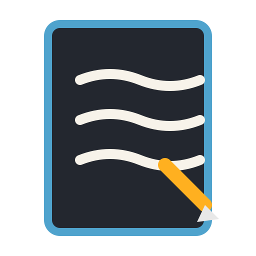

<p align="center">
  
</p>

<h1 align="center">E-Journal</h1>

<p align="center">
  <b>Handwriting and ink for people who write with a pen: open source, local-first, and entirely your own.</b><br>
  Notebooks and pages, pressure-sensitive ink, images and a highlighter, in a native app<br>
  that opens instantly, works offline, and never phones home. Open source, and yours.
</p>

<p align="center">
  
  
  
  
</p>

<p align="center">
  <a href="#features">Features</a> ·
  <a href="#under-the-hood">Under the hood</a> ·
  <a href="#downloads">Downloads</a> ·
  <a href="#requirements">Requirements</a> ·
  <a href="#your-data">Your data</a> ·
  <a href="#get-started">Get started</a> ·
  <a href="#status">Status</a> ·
  <a href="https://github.com/EkarinLB/e-journal/issues">Report an issue</a>
</p>

<br>

<table>
  <tr>
    <td width="25%" valign="top">
      <h3>✍️ Ink that behaves</h3>
      Pressure-sensitive strokes with ballpoint, fountain and brush nibs, Chaikin smoothing, a translucent highlighter, an eraser, and a scribble-to-delete gesture.
    </td>
    <td width="25%" valign="top">
      <h3>⚡ Native and fast</h3>
      A Rust backend with the ink canvas on the system WebView. Opens instantly, starts instantly, and keeps a large notebook scrolling smoothly. No Electron runtime in the shipped app.
    </td>
    <td width="25%" valign="top">
      <h3>🔒 Offline and private</h3>
      Your notes are plain JSON on your own disk. No account, no telemetry, no server, and nothing leaves your computer — because there is nothing to send it to.
    </td>
    <td width="25%" valign="top">
      <h3>🖊️ A real notebook</h3>
      Notebooks and pages, ruled paper, a continuous scroll that makes new pages as you go, a page dock, zoom, hideable UI for distraction-free writing, and light and dark themes.
    </td>
  </tr>
</table>

<br>

## Features

<table>
  <tr>
    <td width="50%" valign="top">
      <h3>Writing</h3>
      Pressure-sensitive pen input with three nib styles (ballpoint, fountain, brush), strokes smoothed with Chaikin subdivision so curves stay clean without looking mechanical. A translucent highlighter that layers over existing ink without hiding it, an eraser, and seven ink colors with a full picker. Undo and redo across strokes, per notebook.
    </td>
    <td width="50%" valign="top">
      <h3>Notebooks</h3>
      Notebooks made of pages, on a home shelf with search over titles. Continuous vertical scrolling that creates pages as you reach the end of the last one, plus a page dock to jump. Delete a page, clear a page, delete a notebook — each write straight to disk so it survives a close.
    </td>
  </tr>
  <tr>
    <td width="50%" valign="top">
      <h3>Pages and images</h3>
      Ruled paper with a margin line, plain paper, and blank. Insert images from disk, move them, resize them, delete them, or drag and drop them straight from a file manager onto the page. Everything on a page is undoable.
    </td>
    <td width="50%" valign="top">
      <h3>Familiar gestures</h3>
      Scribble across a stroke to delete it — the gesture distinguishes deliberate scribbles from loops, underlines and ordinary writing. Scroll by wheel or scrollbar only; drag-to-scroll is off so a pen stroke never moves the page. Pen input is locked while inking, so your palm cannot draw.
    </td>
  </tr>
  <tr>
    <td width="50%" valign="top">
      <h3>Reading your own files</h3>
      Read-only import of Microsoft Journal <code>.ink</code> files, which are SQLite databases: pages, stroke blobs and metadata are decoded locally. Export and re-import a whole library as a single <code>.ejournal</code> file you can keep or move.
    </td>
    <td width="50%" valign="top">
      <h3>A quiet interface</h3>
      Fixed-size controls that stay the size you know, laid out fluidly rather than scaling with your window. Zoom for the canvas and for reading. Hide the whole interface with one keystroke for nothing but the page. Light and dark themes, chosen by you or by your system.
    </td>
  </tr>
</table>

## Under the hood

- **Native, not Electron:** a Rust backend ([Tauri v2](https://tauri.app/)) owns storage, file dialogs and window lifecycle. There is no bundled Chromium in the shipped app, and no Node runtime either.
- **One plain file:** the whole library is a single readable JSON document at `%APPDATA%\E-Journal\e-journal-library.json` on Windows and the equivalent XDG path on Linux. Back it up by copying it. A rolling `.bak` copy of the previous state is kept beside it automatically, and a save that would replace real notes with an empty library is refused.
- **Atomic writes:** every save goes to a temporary file and is renamed into place, so an interrupted write cannot leave you with half a notebook.
- **One instance only:** a second copy of E-Journal focuses the window you already have instead of starting over, so two processes can never fight over your notes.
- **Clean-room:** written from public documentation and observed behaviour only. No proprietary code, file formats, icons or images. Microsoft Journal is a behavioural reference, not a source.
- **Built by CI:** every installer is produced by GitHub Actions from the tagged source, on Linux and Windows, with SHA-256 checksums published alongside.

## Downloads

Latest: **[v0.12.0 — beta](https://github.com/EkarinLB/e-journal/releases/tag/v0.12.0)**

| Platform | File | Size |
|:-:|---|---|
| Windows 64-bit | [`E-Journal_0.12.0_x64-setup.exe`](https://github.com/EkarinLB/e-journal/releases/download/v0.12.0/E-Journal_0.12.0_x64-setup.exe) | 2.5 MB |
| Windows (MSI / managed) | [`E-Journal_0.12.0_x64_en-US.msi`](https://github.com/EkarinLB/e-journal/releases/download/v0.12.0/E-Journal_0.12.0_x64_en-US.msi) | 3.5 MB |
| Debian / Ubuntu | [`E-Journal_0.12.0_amd64.deb`](https://github.com/EkarinLB/e-journal/releases/download/v0.12.0/E-Journal_0.12.0_amd64.deb) | 4.6 MB |
| Linux portable | [`E-Journal_0.12.0_amd64.AppImage`](https://github.com/EkarinLB/e-journal/releases/download/v0.12.0/E-Journal_0.12.0_amd64.AppImage) | 84 MB |

SHA-256 sums for every artifact are in [`checksums.txt`](https://github.com/EkarinLB/e-journal/releases/download/v0.12.0/checksums.txt).

The `.exe` installs for the current user without administrator rights and adds an entry to
Settings → Apps, so it uninstalls normally. The `.deb` installs like any other Debian package;
the AppImage needs FUSE2 on most distributions (`sudo apt install libfuse2`).

> [!NOTE]
> The Windows binaries are **unsigned**, so SmartScreen may warn on first run. Choose
> *More info → Run anyway*, or verify the published SHA-256 sum. Code signing is on the roadmap.

## Requirements

### Windows

| Requirement | Detail |
|---|---|
| Operating system | Windows 10 version 1809 (April 2018) or newer, or Windows 11 |
| Architecture | 64-bit (x86-64) |
| Extra runtimes | **None** |
| Disk space | ~30 MB installed |
| Internet | Only at install time, and only if the WebView2 runtime is missing |

The interface is drawn by the Microsoft Edge WebView2 runtime, which ships with Windows 10
(1809+) and Windows 11; if it is genuinely absent, the installer runs Microsoft's official
bootstrapper for you. You do **not** need the Visual C++ Redistributable — the binary only uses
the Universal CRT (`api-ms-win-crt-*`), which is part of Windows itself. Windows 7 and 8.1 are
not supported.

### Linux

WebKitGTK 4.1 (for the `.deb` and AppImage — pulled in automatically as a package dependency),
`libfuse2` for the AppImage. A Flatpak is being prepared for Flathub.

## Your data

E-Journal works offline: it has no account, no telemetry, and contacts no server at all. Concretely:

- **Your library is one JSON file on your disk.** Nothing is uploaded, encrypted-with-someone-else's-keys, or held anywhere but your machine.
- **A rolling backup sits beside it.** Before each save, the previous version is copied to `e-journal-library.json.bak`.
- **Empty saves are refused.** If a save would wipe real notebooks, E-Journal declines it instead of losing your work.
- **Export is yours.** Save a whole library to `.ejournal` and move it to another machine whenever you like.
- **Nothing to opt out of**, because nothing is collected. There is no crash reporting and no analytics.

## Get started

```sh
git clone https://github.com/EkarinLB/e-journal
cd e-journal
npm install
npm test            # version guard, storage, ink gestures and undo/redo — no GUI needed
npm run tauri dev   # the native app with hot reload
```

A release build needs Rust stable and, on Windows, Visual Studio Build Tools with the
"Desktop development with C++" workload for the MSVC linker:

```sh
npm run tauri build                            # installer under src-tauri/target/release/bundle
cargo test --manifest-path src-tauri/Cargo.toml   # Rust backend unit tests
```

Linux packages (AppImage, `.deb`) are built by CI in
[`.github/workflows/build.yml`](.github/workflows/build.yml), since they cannot be produced from a
Windows host. To build them locally, run [`scripts/setup-linux-build-env.sh`](scripts/setup-linux-build-env.sh)
once in a Linux terminal, then [`scripts/build-linux.sh`](scripts/build-linux.sh).

Contributors and AI agents: the Rust tests, the JS tests and the packaging workflow are all
runnable without a GUI, so a change can be verified without launching the app.

> [!IMPORTANT]
> **Status: beta, and honestly not finished.** The writing experience works end to end and the core
> editor is solid, but E-Journal is young. The gaps we know about, tracked rather than hidden:
>
> - **No version history.** One library file plus a single `.bak`. No timeline, no named snapshots, no undo across sessions.
> - **No typed text**, sticky notes, shapes or lasso selection.
> - **Search covers notebook titles only.** There is no handwriting recognition, so you cannot search what you have written.
> - **`.ink` import is partial.** It reads the page snapshots and works on most files; three of the 25 sample files carry no snapshot and import blank because stroke-blob decoding is unfinished.
> - **No tags, favourites or sorting** — the shelf is one flat list.
> - **Unsigned binaries**, so expect a SmartScreen prompt on Windows.
> - **No macOS build.**
>
> If something breaks, please [file an issue](https://github.com/EkarinLB/e-journal/issues) — early users are the reason the rough edges get found.

## Roadmap

1. Version history with named snapshots
2. Finish stroke-blob decoding so every `.ink` file imports with real ink
3. Handwriting search index, built locally
4. Typed text and shapes
5. Flathub submission and a signed Windows build

## A note on what this is

E-Journal is a clean-room implementation. We observed how a pen-and-paper journal app should
behave, learned the facts that are publicly observable (notebooks contain ordered pages; `.ink`
files are SQLite databases), and then wrote every line of this code ourselves. No proprietary
code, decompiled output, app assets, icons or trademarks are in this repository, and none should
ever be committed to it. The name, artwork and code are ours.

## License

E-Journal is [MIT licensed](LICENSE). Copyright (c) 2026 E-Journal contributors.

Every icon and image in E-Journal is drawn in code for this project or is original artwork.
Microsoft Journal is a behavioural reference only; it is not affiliated with, endorsed by, or
derived from Microsoft, and no Microsoft assets appear here.

## Star history

[](https://www.star-history.com/?repos=EkarinLB%2Fe-journal&type=date&legend=top-
